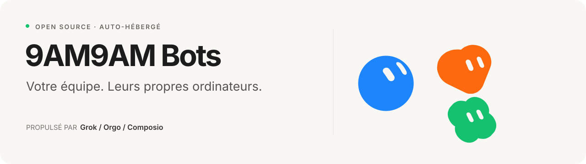

<p align="center">
  
</p>

<p align="center">
  <strong>9AM9AM Bots</strong> — des coéquipiers IA auto-hébergés avec ordinateur, applications connectées, mémoire et voix.<br>
  Intégré à <a href="../../README.md">9AM9AM TEAM</a> · Basé sur <a href="https://github.com/nickvasilescu/grokbot-clone">grokbot-clone</a> (MIT).
</p>

---

## Ce que c'est

9AM9AM Bots donne un rôle à chaque Bot : un nom, une apparence, ses instructions, sa mémoire et son propre bureau Linux. On lui confie une tâche dans le chat, on suit son travail, on peut prendre la main sur son ordinateur, et on retrouve ses livrables dans la Library.

Chaque utilisateur partage une VM Orgo, avec jusqu'à quatre bureaux de Bots actifs en même temps. Les Bots peuvent se déléguer du travail, lancer des sous-agents, participer à des groupes, exécuter des routines et parler en voix réelle.

## Démarrage rapide

### 1. Prérequis

- **Node.js 22.22 ou plus récent**
- Les clés API :
  - `XAI_API_KEY` — xAI (texte + voix)
  - `COMPOSIO_API_KEY` — connexions d'apps et sign-in Google
  - `ORGO_API_KEY` + `ORGO_WORKSPACE_ID` — ordinateurs cloud
  - `SESSION_SECRET` — `openssl rand -hex 32`

### 2. Installation

Depuis la racine du repo `9am9am-team` :

```bash
cd bots/9am9am-bots
npm ci
cp .env.example .env
# renseigner .env
```

`npm ci` installe les dépendances des deux workspaces (`server/` et `web/`). Les scripts d'installation natifs (`better-sqlite3`, `esbuild`, `fsevents`) sont approuvés dans `package.json` via `allowScripts` pour npm 12.

### 3. Lancer en développement

Deux terminaux :

```bash
npm run dev -w server
npm run dev -w web
```

Ouvrir http://localhost:5173. Le front proxifie l'API vers le port 8787.

Pour tester sans Google, mettre `DEV_LOGIN=1` dans `.env` (local uniquement) et utiliser le formulaire email.

### 4. Lancer la version buildée

```bash
npm run build
npm start
```

L'app est servie sur http://localhost:8787. Mettre `APP_URL` et `SERVER_URL` sur cette adresse (ou l'URL HTTPS publique) pour que les redirections de sign-in reviennent au bon endroit. Laisser `DEV_LOGIN=0` dès que le serveur est exposé.

### 5. Vérifier l'installation

```bash
npm run typecheck
npm run smoke
```

`npm run smoke` démarre le serveur avec de fausses clés, vérifie `/api/health`, le login dev, le hachage des sessions, les en-têtes de sécurité et le refus d'un callback OAuth forgé. Aucun appel réel aux providers.

## Améliorations apportées à l'upstream

- **Marque** : 9AM9AM Bots, package names, cookie, events, chemins internes, base SQLite et documentation.
- **Sessions** : les tokens sont hachés avec un pepper (`SESSION_SECRET`) avant stockage ; un dump SQLite ne permet pas de rejouer une session.
- **Cookies** : `HttpOnly`, `SameSite=Lax`, `Secure` automatique quand `SERVER_URL` est en HTTPS (ou `COOKIE_SECURE=1` derrière un proxy TLS).
- **OAuth** : l'attempt de login est lié au navigateur par un cookie court ; un lien de callback ne peut plus connecter la victime au compte de l'attaquant.
- **Rate limit** : le login dev est limité à 10 tentatives/minute par IP.
- **En-têtes** : `X-Content-Type-Options`, `X-Frame-Options`, `Referrer-Policy`, `Permissions-Policy`, HSTS en HTTPS.
- **Démarrage** : validation groupée des variables d'environnement, messages clairs, avertissement si `DEV_LOGIN=1` hors localhost.
- **Arrêt propre** : SIGINT/SIGTERM ferment le serveur et SQLite (avec délai de secours).
- **Smoke test** : `scripts/smoke.sh` vérifie le runtime réel sans clés.
- **Docs** : README français, upstream conservé dans `README.upstream.md`, notices et licence mises à jour.

## Architecture

| Couche | Implémentation |
|---|---|
| Web | React, TypeScript, Vite, Zustand |
| Serveur | Node.js, Hono, SQLite, SSE |
| Agent | Grok Responses API (streaming, tools, mémoire, approbations) |
| Ordinateurs | Orgo VM + un bureau par Bot, viewer noVNC relayé par le serveur |
| Apps | Composio (catalogue, sessions, auth, tools, triggers) |
| Voix | Grok realtime + relais vers la boucle texte |

Détails : [`docs/ARCHITECTURE.md`](docs/ARCHITECTURE.md), [`docs/orgo-builder-guide.md`](docs/orgo-builder-guide.md), [`docs/xai-and-composio.md`](docs/xai-and-composio.md).

## Structure

```text
server/src/     API, agent runtime, tools, intégrations
web/src/        chat, réglages des Bots, apps, viewer, voix
web/artwork/    assets de design des avatars
web/public/     assets statiques
tests/          scripts e2e et harness voix
docs/           architecture et guides d'intégration
scripts/        smoke test
```

## Tests

```bash
npm run typecheck
npm run build
npm run smoke
```

Le test e2e complet (`node tests/e2e.mjs`) appelle les vrais providers et nécessite Chrome ; il n'est pas lancé par le smoke test.

## Coûts et sécurité

- Les appels modèle, les actions Composio et les ordinateurs Orgo utilisent **tes comptes** et peuvent être facturés.
- Le projet upstream n'a pas subi d'audit de sécurité. Les Bots d'un même compte partagent une VM ; les approbations Composio ne couvrent pas toutes les actions possibles via le navigateur ou le shell.
- Ne jamais committer `.env`, la base `data/` ou des captures contenant des données personnelles.
- `DEV_LOGIN=1` est réservé au local. Le serveur affiche un avertissement s'il est activé avec une `APP_URL` non locale.

## Licence et crédits

MIT — voir [`LICENSE`](LICENSE) et [`THIRD_PARTY_NOTICES.md`](THIRD_PARTY_NOTICES.md).

Basé sur [grokbot-clone](https://github.com/nickvasilescu/grokbot-clone) de Nick Vasilescu (MIT). Inspiré par Grok Bot. Construit avec [Grok](https://x.ai), [Orgo](https://orgo.ai) et [Composio](https://composio.dev). Projet indépendant, non affilié à xAI ou Cursor/Anysphere.
