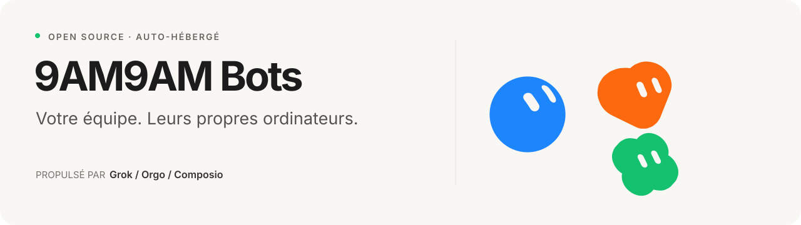

> **Note :** ceci est le README d'origine de `grokbot-clone`, conservé pour référence.
> La version 9AM9AM Bots est décrite dans [`README.md`](README.md).

<p align="center">
  
</p>

<p align="center">
  A self-hosted Grok Bot clone with computer use, connected apps, memory, and voice.<br>
  Built with the public Grok API, Orgo, and Composio.
</p>

<p align="center">
  <a href="#quick-start">Quick start</a> ·
  <a href="#what-you-can-do">Features</a> ·
  <a href="docs/ARCHITECTURE.md">Architecture</a> ·
  <a href="#development">Development</a> ·
  <a href="https://github.com/nickvasilescu/grokbot-clone/issues">Issues</a>
</p>

---

Give a Bot a job, connect the apps it needs, and follow its work in chat. Each Bot has a name, a look, its own memory, and a desktop you can watch or take over. Bots can work together, run recurring tasks, and talk with you over voice.

Grokbot Clone recreates the Grok Bot experience with a runtime you can run and modify yourself. You bring your own API keys; conversations, settings, and agent state live in a local SQLite database.

## What you can do

- **Give every Bot a role.** Set its instructions, appearance, thinking effort, skills, and memories. Make one your primary point of contact.
- **Put it to work on a computer.** Bots browse websites, run shell commands, and use a full Linux desktop through Orgo. Watch live, take control, and find saved work in the Library.
- **Connect your apps.** Google sign-in and app connections run through Composio. Read actions run automatically; Composio write actions pause for approval, with an option to remember your choice.
- **Build a team.** Bots delegate work, start subagents, and join group chats with @mentions.
- **Keep work moving.** Schedule routines, react to app events, and let your primary Bot check in proactively.
- **Keep context.** Bots retain durable memories, recall earlier facts, and compact long conversations.
- **Talk it through.** Realtime voice calls hand tasks to the same Bot runtime. Voice selection, speed, previews, and push-to-talk dictation are included.

Each user's Bots share one Orgo VM, with up to four separate Bot desktops active at once. Idle computers can sleep and wake when needed.

## Quick start

### 1. Get the project

Install **Node.js 22.22 or newer**, then:

```bash
git clone https://github.com/nickvasilescu/grokbot-clone.git
cd grokbot-clone
npm ci
cp .env.example .env
```

### 2. Configure your keys

Fill in these values in `.env`:

| Variable | Purpose |
| --- | --- |
| `XAI_API_KEY` | Grok text and voice API access |
| `COMPOSIO_API_KEY` | App connections, tool catalog, and Google sign-in |
| `ORGO_API_KEY` | Cloud computer access |
| `ORGO_WORKSPACE_ID` | Workspace in which to create computers |
| `SESSION_SECRET` | Secret used to sign sessions |

Generate a session secret with:

```bash
openssl rand -hex 32
```

Paste the result into `SESSION_SECRET`. The example environment file includes the local URLs, computer size, and optional voice settings. The default text model is `grok-4.7`; change `XAI_MODEL` to use another compatible model available to your account.

### 3. Start the app

Run the API in one terminal:

```bash
npm run dev -w server
```

Run the frontend in a second terminal:

```bash
npm run dev -w web
```

Open **[localhost:5173](http://localhost:5173)**. The frontend proxies API requests to port `8787`.

Use **Sign in with Google**, or use the local email form with `DEV_LOGIN=1` (enabled in `.env.example`). Your account starts with a primary Bot. Create another Bot, give it a role, and send it a task.

The first computer task provisions an Orgo VM. Model calls, app actions, and computers use your provider accounts and may incur charges.

### Run a built version

```bash
npm run build
npm start
```

The API serves the built app at **[localhost:8787](http://localhost:8787)**. Set both `APP_URL` and `SERVER_URL` to that address, or to your public HTTPS URL when hosting it, so sign-in redirects return to the right place. Disable `DEV_LOGIN` before exposing the server to other users.

## How it works

| Layer | Implementation |
| --- | --- |
| Web app | React, TypeScript, Vite, and Zustand |
| Server | Node.js, Hono, SQLite, and Server-Sent Events |
| Agent runtime | Grok Responses API with streaming, tools, memory, and approval handling |
| Computers | Orgo VM lifecycle and per-Bot desktops; noVNC viewer through a server-side relay |
| Connected apps | Composio catalog, sessions, authentication, tools, and triggers |
| Voice | Grok realtime sessions with a relay into the text agent's task loop |

The server owns the agent loop. It builds context, streams a model response, executes tools, pauses for approvals when required, and continues until the task is done. Voice hands work to that same loop.

For the details, read the [architecture guide](docs/ARCHITECTURE.md), [Orgo integration guide](docs/orgo-builder-guide.md), and [Grok and Composio integration guide](docs/xai-and-composio.md).

## Development

```bash
npm run typecheck       # Check the server and frontend
npm run build           # Build both workspaces
```

The main source directories are:

```text
server/src/     API routes, agent runtime, tools, and integrations
web/src/        Chat, Bot settings, app connections, computer viewer, and voice
web/artwork/    Original design assets used to generate Bot avatars
web/public/     Static UI assets
tests/          Playwright integration and voice scripts
docs/           Architecture and integration guides
```

### Integration tests

With the server running and `DEV_LOGIN=1`:

```bash
node tests/e2e.mjs http://localhost:8787
```

The suite creates a temporary Bot and exercises chat, computer tools, the live viewer, search, app connections, voice sessions, groups, and settings. Set `E2E_EMAIL` to choose the test account. It calls real providers and requires Google Chrome at `/usr/bin/google-chrome`.

The separate `tests/voice-call.mjs` script is a development harness for two-way audio. It currently contains machine-specific paths and needs adapting before use on another system.

### Contributing

Bug reports, improvements, and pull requests are welcome. For a bug, include the steps to reproduce, expected behavior, Node version, and relevant logs with secrets removed. For larger changes, open an [issue](https://github.com/nickvasilescu/grokbot-clone/issues) first to discuss the approach.

Keep changes focused, run the typecheck and build, and describe how you verified the affected flow. Never commit API keys, `.env` files, databases, or screenshots containing personal information.

## Project status

This is an experimental project. The core workflows are implemented, but it has not undergone a security audit. Bots within an account share a VM; Composio write approvals do not cover every possible action a Bot can take through its browser or shell.

Planned work includes a faster executor inside each VM, file-based skills and task recording, a local-computer companion, and meeting support.

Configuration options for idle suspension, memory consolidation, and history compaction are described in the [architecture guide](docs/ARCHITECTURE.md). Start with [`.env.example`](.env.example) for connection settings.

## License and credits

Project code is available under the [MIT license](LICENSE). Third-party artwork and trademarks retain their owners' rights; see [third-party notices](THIRD_PARTY_NOTICES.md).

Inspired by Grok Bot. Built with [Grok](https://x.ai), [Orgo](https://orgo.ai), and [Composio](https://composio.dev). This is an independent project, unaffiliated with xAI or Cursor/Anysphere.
